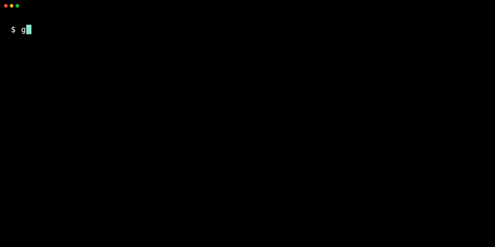
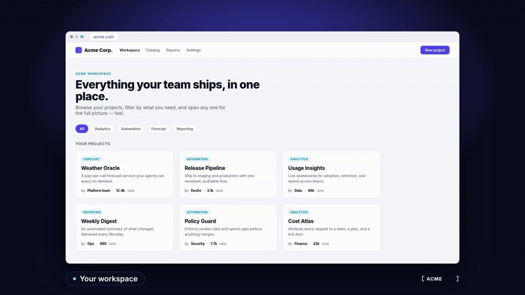
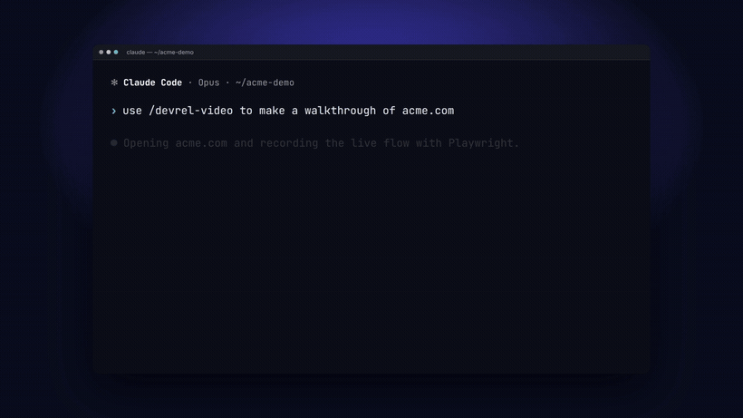

<p align="center">
  
</p>

<h1 align="center">DevRel Video Studio</h1>
<p align="center">From product workflow to polished demo.</p>
<p align="center">
  <a href="#quick-start">Quick start</a> ·
  <a href="#worked-videos">Worked videos</a> ·
  <a href="docs/usage.md">Usage</a> ·
  <a href="#contributing-and-support">Contribute</a>
</p>
<p align="center">
  <a href="LICENSE"></a>
  <a href="https://github.com/aaitor/skill-video-studio/actions/workflows/quality.yml"></a>
</p>

A local video-production workspace driven by the **`/devrel-video` Claude Code skill**. Capture real product interactions with Playwright CLI, compose title cards, chapters, and CTAs with HyperFrames, then master and inspect the result with FFmpeg. Start with a silent walkthrough; add narration, music, subtitles, or your own presenter footage when needed.

## Demo



A real Claude Code session using the installed project skill: clone the studio, prepare an Acme walkthrough brief, and inspect the three-beat plan on a black background. This short demo stops **before capture and rendering**; it does not claim a video was produced. The [recording guide](examples/README.md) includes the actual generated brief and reproduction command.

## Quick start

**For planning:** Git and authenticated Claude Code. Clone the full workspace so its native skill and project layout stay together:

```bash
git clone https://github.com/aaitor/skill-video-studio.git
cd skill-video-studio
claude
```

Ask Claude:

```text
/devrel-video Prepare a 25-second silent walkthrough brief for the bundled
Acme app: show the workspace, filter by category, then open a project.
Reuse brands/acme. Show the plan before capture or rendering.
```

Expected result: a project brief and a concrete beat plan. For a complete video, install the [capture/render prerequisites](docs/installation.md#capture-and-rendering-prerequisites) and follow the [worked walkthrough](projects/example-walkthrough/README.md). The production stack needs Node.js 22+, FFmpeg/ffprobe, Chromium, and the helper-specific Python dependencies. Optional narration and avatars require your own additional services or GPU setup.

## Features

- **Real product capture:** browser interaction scripts with explicit beats and stable selectors.
- **Branded composition:** title, browser frame, chapters, and CTA in a HyperFrames timeline.
- **Local mastering and QA:** master/web copies, ffprobe checks, contact sheet, and thumbnail.
- **Optional audio:** six local music styles, narration-driven timing, and voice variants.
- **Optional presentation:** subtitles, private bring-your-own presenter footage, and terminal/browser sequences.
- **Source-based workflow:** reusable brands, briefs, templates, and two complete worked examples.

Portrait/social output profiles remain on the roadmap. Full capture/render depends on your local toolchain; offline CI checks sources and selected local utilities, not the complete production stack. See [workflow](docs/workflow.md) and [usage](docs/usage.md).

## Worked videos

**Product walkthrough:** a local Acme fixture, real browser capture, narration/music, and EN/ES subtitles. [Source and commands](projects/example-walkthrough/README.md) · [Watch with sound](https://youtu.be/H6npd3uuqls).

[](https://youtu.be/H6npd3uuqls)

**Composed CLI/browser film:** a multi-environment example whose terminal scenes are authored HTML reenactments. [Source and explanation](projects/example-cli-tour/README.md) · [Watch with sound](https://youtu.be/lvpKaYUVNws).

[](https://youtu.be/lvpKaYUVNws)

The longer examples remain intact. Generated MP4/audio files are ignored; rebuild them from the included sources. See [usage prompts](docs/usage.md) for silent, narrated, avatar, voice-swap, and multi-environment requests.

## Configuration

Each video uses `projects/<slug>/brief.yaml`, brand tokens under `brands/<name>/`, and generated output under its project folder. Optional private settings live outside Git, selected by `DEVREL_VIDEO_ENV`.

| Setting | Purpose |
| --- | --- |
| `brief.yaml` | Product URL, audience, message, beats, brand, duration, and optional layers |
| `ORPHEUS_URL` / `ORPHEUS_KEY` | Your optional narration endpoint and token |
| `AVATAR_HOST` / `LS_DIR` | Your optional SSH GPU host and LatentSync checkout |
| `BGM_STYLE` | Local background-music style; default `corporate` |

See [configuration](docs/configuration.md), the [actual brief template](.claude/skills/devrel-video/templates/brief.example.yaml), and [security/privacy guidance](docs/security-and-privacy.md). Keep private footage and credentials outside this public repository.

## How it works

Brief → explore → brand → capture → compose → optional layers → render/QA → thumbnail. The [skill](.claude/skills/devrel-video/SKILL.md) coordinates existing tools rather than replacing them. Detailed production steps are in the [workflow guide](docs/workflow.md) and [production notes](.claude/skills/devrel-video/references/production-notes.md).

## Repository layout

```text
.claude/skills/devrel-video/  Skill instructions, scripts, templates, production notes
brands/                     Brand tokens and logos
projects/                   Curated public examples; private projects stay ignored
examples/                   Real harness recording, public input, generated brief
assets/                     Shared banner, social card, and short terminal GIF
docs/                       Onboarding, usage, configuration, troubleshooting
```

## Documentation

- [Installation and production prerequisites](docs/installation.md)
- [Configuration](docs/configuration.md)
- [Prompts and optional layers](docs/usage.md)
- [Workflow](docs/workflow.md)
- [Troubleshooting](docs/troubleshooting.md)
- [Security, privacy, and media rights](docs/security-and-privacy.md)
- [Banner generation and social preview](docs/branding.md)
- Original references: [studio design guide](local-devrel-video-studio-guide.md) · [avatar guide](local-talking-video-avatar-guide.md)

## Contributing and support

Use [Issues](https://github.com/aaitor/skill-video-studio/issues) for questions, bugs, and ideas. Read [CONTRIBUTING.md](CONTRIBUTING.md) and [CODE_OF_CONDUCT.md](CODE_OF_CONDUCT.md); report vulnerabilities privately through [SECURITY.md](SECURITY.md).

Install `requirements-dev.txt` in a virtual environment and run `python3 scripts/check.py`. See [CHANGELOG.md](CHANGELOG.md) for changes. Live recordings, service calls, GPU jobs, and full renders are manual validation steps.

## License

[MIT](LICENSE) for original studio content. Embedded banner fonts retain their [OFL notices](assets/font-notices/NOTICE.md); external tools/models/media retain their own terms. See [licensing](docs/licensing.md).

---

Built by [Aitor Argomaniz](https://github.com/aaitor) · [LinkedIn](https://www.linkedin.com/in/aitorargomaniz) · [More open source](https://github.com/aaitor?tab=repositories)
